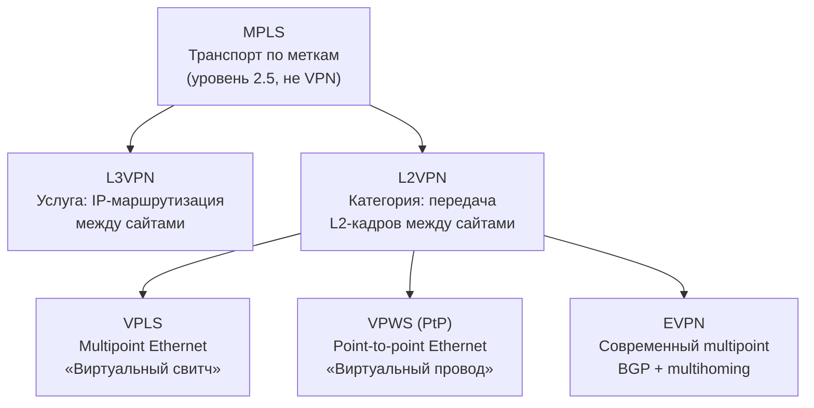

# OSI

**OSI (Open Systems Interconnection)** — это эталонная модель взаимодействия открытых систем, разработанная Международной организацией по стандартизации (ISO) в 1984 году. Она описывает, как данные передаются по сети от одного устройства к другому, разбивая этот процесс на 7 уровней.

| № | Уровень (рус)   | Уровень (eng) | Что делает                                          | Примеры                     |
|---|-----------------|---------------|-----------------------------------------------------|-----------------------------|
| 7 | Прикладной      | Application   | Интерфейс для программ (браузер, почта)             | HTTP, DNS, FTP, SMTP        |
| 6 | Представления   | Presentation  | Кодировки, шифрование, сжатие                       | SSL/TLS, JPEG, ASCII        |
| 5 | Сеансовый       | Session       | Управление сессиями (кто, когда, как долго)         | RPC, NetBIOS                |
| 4 | Транспортный    | Transport     | Доставка «от порта до порта», надёжность            | TCP, UDP                    |
| 3 | Сетевой         | Network       | Маршрутизация между сетями, IP-адреса               | IP, ICMP, OSPF              |
| 2 | Канальный       | Data Link     | Доставка внутри одной сети, MAC-адреса              | Ethernet, Wi-Fi, ARP        |
| 1 | Физический      | Physical      | Биты, сигналы, кабели, разъёмы                      | Витая пара, оптика, радио   |

Реальные сети работают по модели **TCP/IP** (4 уровня), которая появилась раньше и стала практическим стандартом. OSI остаётся теоретической эталонной моделью, удобной для описания и обучения, но в чистом виде в интернете не используется.

# Модель TCP/IP

**TCP/IP (Transmission Control Protocol / Internet Protocol)** — это не один протокол, а стек (набор) сетевых протоколов, на котором построен весь современный интернет и большинство локальных сетей. Название происходит от двух ключевых протоколов: TCP (обеспечивает надёжную доставку) и IP (обеспечивает адресацию и маршрутизацию).

| № | Уровень                                              | Соответствие в OSI                     | Задачи                                          | Примеры протоколов                     |
|---|------------------------------------------------------|----------------------------------------|-------------------------------------------------|----------------------------------------|
| 4 | Прикладной (Application)                             | 5–7 (Session, Presentation, Application) | Сетевые службы для пользователя                 | HTTP, HTTPS, FTP, SMTP, DNS, SSH, Telnet |
| 3 | Транспортный (Transport)                             | 4 (Transport)                          | Доставка между процессами (порты), надёжность   | TCP, UDP, SCTP                         |
| 2 | Межсетевой (Internet)                                | 3 (Network)                            | Адресация и маршрутизация между сетями          | IP (IPv4, IPv6), ICMP, ARP, IGMP       |
| 1 | Канальный / Доступа к сети (Link/Network Access)     | 1–2 (Physical, Data Link)              | Передача кадров по физической среде             | Ethernet, Wi-Fi, PPP, DSL              |

**TCP/IP** — это де-факто стандарт сетевого взаимодействия. Если OSI отвечает на вопрос «как логически описать сеть», то TCP/IP отвечает на вопрос «как реально заставить её работать». Все современные операционные системы (Windows, Linux, macOS, Android, iOS) имеют встроенный стек TCP/IP.

# BGP

**BGP (Border Gateway Protocol)** — это протокол маршрутизации, который связывает между собой все автономные системы интернета. Если по-простому: BGP — это «почтовая служба» интернета, которая решает, по какому пути отправить данные между огромными сетями.

**Автономная система (Autonomous System, AS)** — это большая сеть, управляемая одной организацией с единой политикой маршрутизации. У каждой AS есть уникальный номер (ASN).

BGP работает в двух режимах. Это не два разных протокола, а две разные роли одного и того же протокола.

| Режим    | Где работает        | Задача                                                                                                                             |
|----------|---------------------|------------------------------------------------------------------------------------------------------------------------------------|
| **eBGP** | Между разными AS    | Обмениваться информацией о маршрутах с соседними AS. Здесь принимаются ключевые политики: каким провайдерам мы готовы платить за трафик, а каких просто пропускаем бесплатно. |
| **iBGP** | Внутри одной AS     | Распространять маршруты, полученные по eBGP, между всеми пограничными роутерами внутри вашей сети. Это нужно, чтобы все «выходы» из AS знали, куда вести трафик. |

## Принцип работы BGP 

- **Транспорт**: BGP работает поверх TCP и использует порт 179. Это гарантирует надёжную доставку сообщений.
- **Соседи (Peers/Neighbors)**: Два роутера, которые хотят обмениваться маршрутами, должны вручную настроить друг друга как «соседей» и установить TCP-сессию.
- **Обмен**: После установки сессии роутеры обмениваются всей таблицей маршрутов, а затем только инкрементными обновлениями (если что-то изменилось).
- **Ключевой атрибут** — AS_PATH: Каждый маршрут в BGP помечен списком номеров AS, через которые он проходит. Это нужно для защиты от петель (если роутер видит свой AS в пути, он отбрасывает маршрут) и для выбора пути.

# OSPF

**OSPF (Open Shortest Path First)** —  это протокол маршрутизации, который используется внутри одной сети (например, внутри компании или провайдера), чтобы роутеры сами находили кратчайшие пути для передачи данных.
Это внутренний «навигатор» по своей сети, а iBGP — это способ раздать всем своим роутерам информацию о маршрутах во внешний мир, полученную через eBGP. Они не заменяют, а дополняют друг друга: OSPF доставляет пакет до пограничного роутера, а BGP (eBGP + iBGP) решает, куда отправить его дальше за пределы AS.

|                        | OSPF (IGP)                                                  | iBGP                                                                                              |
|------------------------|-------------------------------------------------------------|---------------------------------------------------------------------------------------------------|
| **Что распространяет** | Маршруты внутри AS (к своим сетям)                          | Маршруты извне AS (к чужим сетям), полученные через eBGP                                          |
| **Зачем нужен**        | Чтобы роутеры внутри AS знали, как добраться друг до друга  | Чтобы все пограничные роутеры AS знали внешние маршруты и могли их согласованно использовать      |
| **Источник маршрутов** | Локальные сети организации                                  | eBGP-соседи (другие AS)                                                                           |

# VPLS / MPLS 

**MPLS** — это технология транспорта (как доставляются пакеты). Механизм пересылки пакетов по меткам. 
Работает на уровне 2.5 (между канальным и сетевым). Сам по себе не является VPN — это транспорт, «дороги». На нём строятся услуги.

**VPLS** — это услуга (что именно доставляется), а именно:
- **L3VPN** - провайдер маршрутизирует IP между сайтами клиента. Работает поверх MPLS. Клиент видит IP-сеть, провайдер берёт маршрутизацию на себя. Использует VRF, RD, RT, MP-BGP.
- **L2VPN** - Категория, зонтичный термин для всех услуг, передающих L2-кадры (Ethernet) через сеть провайдера. Работает поверх MPLS. Включает в себя несколько конкретных реализаций:
    - **VPLS** — Это «виртуальный свитч» для многих точек. Все сайты видят друг друга как в одном LAN.
    - **VPWS** — Это «виртуальный провод» между двумя точками. Как если бы ты протянул кабель между двумя офисами.
    - **EVPN** — современная железная дорога с автопилотом.

## MPLS и услуги поверх него

| Термин        | Что это                                                                 | Уровень | Роль                          | Ключевые понятия                                      |
|---------------|--------------------------------------------------------------------------|---------|-------------------------------|-------------------------------------------------------|
| **MPLS**      | Механизм пересылки пакетов по меткам. Транспорт. Сам по себе не VPN      | 2.5     | Транспорт                     | Метка, LSP, LSR, LER, shim header                     |
| **L3VPN**     | Услуга: провайдер маршрутизирует IP между сайтами клиента               | L3      | Услуга поверх MPLS            | VRF, RD, RT, MP-BGP (VPNv4)                           |
| **L2VPN**     | Зонтичный термин: провайдер передаёт L2-кадры через свою сеть           | L2      | Категория услуг поверх MPLS   | PW, VSI                                               |
| ├ **VPLS**    | Multipoint Ethernet. «Виртуальный свитч» для многих сайтов              | L2      | Реализация L2VPN              | VSI, PW, MAC-обучение, flooding                       |
| ├ **VPWS (PtP)** | Point-to-point Ethernet. «Виртуальный провод» между двумя точками    | L2      | Реализация L2VPN              | PW, без MAC-обучения                                  |
| └ **EVPN**    | Современная multipoint-реализация. BGP для сигнализации, multihoming   | L2      | Реализация L2VPN              | BGP, control-plane MAC-обучение, multihoming          |

## Формулы для запоминания

- **OSI** — 7 уровней. **TCP/IP** — 4 уровня.
- **OSPF** — внутри AS. **BGP** — между AS.
- **MPLS** — транспорт. **L3VPN / L2VPN** — услуги.
- **L2VPN** = {VPLS, VPWS, EVPN} — категория, а не конкретная услуга.
- **VPLS** — multipoint. **VPWS** — point-to-point. **EVPN** — современная замена VPLS.
- **L3VPN** — провайдер маршрутизирует IP. **L2VPN** — провайдер коммутирует Ethernet.