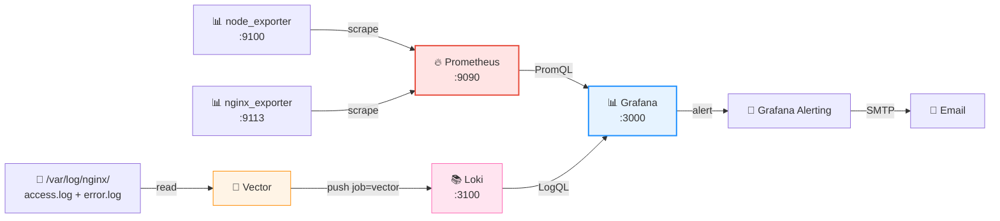

# 📝 Конспект: Nginx Observability Stack — полный путь

Построили полный стек наблюдаемости для Nginx: от сбора метрик и логов до визуализации и алертинга с уведомлениями на почту.


# 📦 Этап 1: Сбор метрик (Prometheus)

### Что настроили
Файл `/etc/prometheus/prometheus.yml`:
```yaml
global:
  scrape_interval: 15s
  evaluation_interval: 15s

scrape_configs:
  - job_name: "prometheus"
    static_configs:
      - targets: ["127.0.0.1:9090"]

  - job_name: "node_exporter"
    static_configs:
      - targets: ["127.0.0.1:9100"]

  - job_name: "nginx_exporter"
    static_configs:
      - targets: ["127.0.0.1:9113"]
```

## Ключевые моменты

| Что             | Значение                                          |
|-----------------|---------------------------------------------------|
| **Pull-модель** | Prometheus сам скрейпит `/metrics` каждые 15s     |
| **Job names**   | Важны для алертов (`up{job="node_exporter"}`)     |
| **stub_status** | Nginx отдаёт метрики на `:8080/stub_status`       |
| **nginx_exporter** | Скрейпит `stub_status`, отдаёт на `:9113`     |

# 📦 Этап 2: Сбор логов (Vector → Loki)

### Что настроили
Файл `/etc/vector/vector.yaml`:
```yaml
sources:
  nginx_access:
    type: file
    include: [/var/log/nginx/access.log]
    read_from: beginning

  nginx_error:
    type: file
    include: [/var/log/nginx/error.log]
    read_from: beginning

transforms:
  parse_access:
    type: remap
    inputs: [nginx_access]
    source: |
      . = parse_nginx_log!(string!(.message), "combined")
      .log_type = "access"

  parse_error:
    type: remap
    inputs: [nginx_error]
    source: |
      .log_type = "error"

sinks:
  loki:
    type: loki
    inputs: [parse_access, parse_error]
    endpoint: http://localhost:3100
    encoding:
      codec: json
    labels:
      job: vector
```

## Ключевые моменты

| Что                | Значение                                              |
|--------------------|-------------------------------------------------------|
| **Vector**         | Агент сбора логов (Rust, быстрый)                     |
| **Sources**        | Читает файлы, `read_from: beginning` — с начала       |
| **Transforms**     | VRL-парсинг: `parse_nginx_log!(..., "combined")`      |
| **log_type**       | Метка `access` / `error` для фильтрации               |
| **Sink**           | `loki` — отправка в Loki                              |
| **labels.job=vector** | Обязательная метка для запросов                    |

# 📦 Этап 3: Визуализация (Grafana)

## Data Sources

- **Prometheus**: `http://localhost:9090`
- **Loki:** `http://localhost:3100`

## Дашборд "Nginx Overview" — 6 панелей

| Панель       | Тип         | Запрос                                                                                          | Источник   |
|--------------|-------------|-------------------------------------------------------------------------------------------------|------------|
| **Nginx Status** | Stat        | `nginx_up`                                                                                      | Prometheus |
| **CPU Load**     | Time series | `100 - avg(rate(node_cpu_seconds_total{mode="idle"}[5m])) * 100`                                | Prometheus |
| **RAM Usage**    | Time series | `(1 - node_memory_MemAvailable_bytes / node_memory_MemTotal_bytes) * 100`                       | Prometheus |
| **RPS**          | Time series | `rate(nginx_http_requests_total[1m])`                                                           | Prometheus |
| **Error Logs**   | Logs        | `{job="vector"} \| json \| log_type="error"`                                                    | Loki       |
| **Top 10 IPs**   | Pie chart   | `topk(10, sum(count_over_time(({job="vector"} \| json \| log_type="access")[1h])) by (client))` | Loki       |

# 📦 Этап 4: Алертинг (Grafana Alerting)

Настройка SMTP в `/etc/grafana/grafana.ini`:
```ini
[smtp]
enabled = true
host = smtp.yandex.ru:587
user = andy-obv@yandex.ru
password = <app-password>
skip_verify = true
from_address = andy-obv@yandex.ru
from_name = Grafana
```

# 🧠 Ключевые принципы, которые усвоили

| Компонент      | Роль                        |
|----------------|-----------------------------|
| **exporter**   | Отдаёт метрики              |
| **Prometheus** | Собирает и хранит метрики   |
| **Vector**     | Собирает и парсит логи      |
| **Loki**       | Хранит логи                 |
| **Grafana**    | Визуализирует + алертит     |
| **SMTP**       | Доставляет уведомления      |

## Pull vs Push

Метрики: Prometheus pull (сам забирает).
Логи: Vector push (отправляет в Loki).