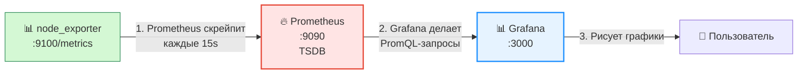

# Зачем нужен мониторинг?

- **Мониторинг позволяет узнавать о надвигающихся проблемах заранее.** Сбор телеметрии позволяет настроить оповещения о приближении определённых параметров к критическим (например, о заполнении диска или подозрительном уменьшении числа запросов к сервису). У команды появляется возможность устранить проблему до того, как она повлияет на пользователей.

- **Исторические данные позволяют оптимальнее управлять ресурсами.** Нагрузка на сервис редко бывает постоянной и равномерной — чаще всего поток обращений к сервису имеет сезонность. Например, большая часть пользователей интернет-магазина будет активна в дневное время, а ночью нагрузка будет спадать. Исторические данные, предоставляемые мониторингом, позволяют отслеживать такие изменения и оптимизировать расходы на инфраструктуру без риска подвести пользователей.

- **Мониторинг облегчает Capacity Planning.** Развивающийся сервис будет привлекать всё больше пользователей, для обслуживания которых потребуются новые ресурсы. Мониторинг позволяет увидеть тренды, разумно планировать и обосновывать заказы новых мощностей для сервиса.

Наконец, не стоит забывать и о DevOps-фреймворке CALMS: оказывается, мониторинг пронизывает и поддерживает каждый из основополагающих принципов DevOps:

- **Culture:** общий мониторинг становится «единым источником правды» для всех. И разработчики, и операторы смотрят на одни и те же графики, что стимулирует совместное обсуждение проблем и их причин.

- **Automation:** на основе мониторинга строятся автомасштабирование или автоматический откат неудачного релиза.

- **Lean:** мониторинг помогает измерить длительность цикла от внесения изменения до его попадания в прод, время на ручные операции и частоту дефектов.

- **Measurement:** метрики описывают не только инфраструктуру и код — мониторинг может собирать метрики бизнеса (конверсия, активные пользователи) и DORA-метрики. Это важно, потому что управлять можно только измеримыми величинами.

- **Sharing:** делясь опытом, команде стоит опираться на реальные графики и данные: это не только наглядно передаст масштаб решённой задачи, но и позволит впоследствии идентифицировать схожие ситуации в других командах.

## Логи

Приложения, сервера и в целом любая сложная система во время работы оставляет заметки обо всех важных событиях в системе — **логи**. Эти записи позволяют отследить, какие действия совершила система, и на основе этих наблюдений сделать выводы о корректности её поведения.

| Свойство              | Какие бывают логи        | Комментарий                                                                                                                                                                                                                                                                                                                                 |
|-----------------------|--------------------------|----------------------------------------------------------------------------------------------------------------------------------------------------------------------------------------------------------------------------------------------------------------------------------------------------------------------------------------------|
| **Структура записи**  | **Структурированные**    | Логи имеют определённый формат (например, JSON, logfmt, nginx combined log), требующий от приложения заполнить все необходимые поля записи. Такие логи удобно хранить и обрабатывать, но для этого в приложении нужен единый фреймворк логирования. В редких случаях формат события может плохо вписываться в выбранный шаблон.              |
|                       | **Неструктурированные**  | События записываются в свободной форме. Этот подход требует минимальных усилий со стороны разработчика, позволяя в любой момент добавить логирование нового события в любом месте приложения. Хранить и анализировать такие логи обычно нелегко, поэтому они встречаются всё реже. Пример: вывод команды `dmesg` в Linux.                       |
| **Сериализация**      | **Текстовые**            | Традиционные события представляют из себя обычный текст. После записи в файл их можно открыть и просмотреть в любом текстовом редакторе.                                                                                                                                                                                                     |
|                       | **Бинарные**             | Данные в несжатом текстовом формате обычно занимают много места и требуют дополнительных вычислительных ресурсов для конструирования в коде приложения. Бинарный формат избавляет от затрат на сериализацию и занимает меньше места. Но работать с такими логами сложнее: для просмотра нужны специальные утилиты, которые поддерживают этот формат. Пример: логи systemd в Linux, требующие вызова команды `journalctl` для просмотра. |
| **Получатель логов**  | **С записью в файл**     | Самый простой способ сохранить логи — позволить приложению самостоятельно записать их в файл. У этого решения, однако, есть существенные недостатки: во-первых, чтобы логи не забивали диск, их надо ротировать — это ложится на плечи разработчика, и кроме того, логика между приложениями неизбежно будет отличаться, во-вторых, приложение не сможет добавлять новые записи при сбое диска или файловой системы, и новые события будут утрачены. |
|                       | **Потоковые**            | Отправив запись о событии, приложение сразу забывает о нём. Такой подход позволяет передать ответственность за доставку и хранение логов системе мониторинга, упрощая приложение и обеспечивая унифицированное решение. Примерами могут служить отправка логов в сервис syslog или простая отправка в stdout, рекомендуемая для контейнеризированных приложений. |

Поскольку логи — самый старый и распространённый формат телеметрии, инженеры продолжают сталкиваться с различными форматами даже в пределах одной системы. 

Привести всё к единому виду, скорее всего, не получится: выбранный способ сбора данных может не поддерживаться приложением. Чтобы решить эту проблему, обычно используются специальные **коллекторы**, такие как Vector, FluentBit или FluentD. Они имеют модульную архитектуру, которая позволяет собирать логи с хоста в разных форматах, приводить их к желаемому виду и отправлять в общее хранилище.

## Метрики

Наблюдая за состоянием сервиса, полезно понимать среднее время ответа, динамику RPS и объём потребляемой памяти. Эти параметры не привязаны к отдельным событиям — они **непрерывно** отражают состояние системы и в каждый момент времени выражаются конкретным числом.

Для отслеживания таких параметров используют метрики — временные ряды, то есть последовательность числовых значений с метками времени. Для их хранения и обработки применяют специализированные базы данных — Time Series Database (TSDB). Примеры: Prometheus, VictoriaMetrics, InfluxDB. 

Говоря о метриках, важно различать два подхода к их сбору — **pull** и **push**.

В **pull-модели** центральная БД сама подключается к агентам или инструментированным приложениям и «вытягивает» значения метрик. Она же определяет частоту опроса. Задача агентов — быстро собрать и отдать актуальные данные по запросу.

В **push-модели** БД ожидает входящие соединения, а агенты сами установят соединение и отправят метрики, когда посчитают нужным.

Современные базы обычно поддерживают оба режима, что позволяет выбрать подходящий вариант.

## Алерты

Под алертингом обычно понимают сервис, который по заданным правилам отслеживает метрики и отправляет уведомление при выходе за пороги. Причины сбоев могут быть сложными, но почти всегда есть явные сигналы: отказ большей части реплик, резкий рост среднего времени ответа БД, отсутствие трафика на интерфейсе. Алертинг не называет причину — его задача вовремя привлечь внимание инженера к подозрительным событиям в системе.

## Наблюдаемость

Идеи наблюдаемости легли в основу развивающегося фреймворка OpenTelemetry, который описывает формат логов и метрик, а также протоколы их передачи. В его философии наблюдаемость строится вокруг трёх типов телеметрии, включая **трейсы** — особенно важные в микросервисной архитектуре.

В приложениях из десятка или даже десятков сервисов один клиентский запрос может пройти через несколько узлов: попасть на разные реплики, обратиться к БД, отправить сообщения и выполнить другие операции. Трейсы позволяют связать все события, относящиеся к одному запросу, в единое целое.

Один трейс описывает один клиентский запрос и показывает две вещи: через какие узлы и сервисы он прошёл и сколько времени занял каждый шаг. Эти шаги называются **спанами** — интервалами выполнения конкретной операции. 

Например, бэкенд может открыть спан перед запросом к БД и закрыть его после получения ответа. Так получают точное время работы базы. Если сервис начинает отвечать медленнее из-за БД, трейс сразу покажет, что задержка возникла в базе, а не в коде приложения.

# Prometheus

Prometheus — система мониторинга и база данных временных рядов (TSDB), которая сама забирает (pull) метрики с приложений по HTTP.

Экосистема Prometheus включает множество **экспортёров** — агентов, которые собирают данные из систем, не поддерживающих Prometheus «из коробки», и отдают их в формате метрик Prometheus.

## Ключевые концепции

| Понятие            | Что это                                                              |
|--------------------|----------------------------------------------------------------------|
| **Metric**         | Временной ряд: имя + метки + значение + timestamp                    |
| **Pull-модель**    | Prometheus сам опрашивает `/metrics` каждые N секунд                 |
| **Exporter**       | Адаптер, отдающий метрики (`node_exporter`, `kube-state-metrics`)    |
| **Service Discovery** | Автопоиск целей через K8s API (поды, сервисы)                     |
| **PromQL**         | Язык запросов к метрикам                                             |
| **TSDB**           | Встроенное хранилище (по умолчанию 15 дней retention)                |

Пример `prometheus.yml`

```yaml
global:
  scrape_interval: 15s
  evaluation_interval: 15s

scrape_configs:
  - job_name: "prometheus"
    static_configs:
      - targets: ["localhost:9090"]
        labels:
          app: "prometheus"
  - job_name: "node_exporter"
    static_configs:
      - targets:
          - "localhost:9100"
```

- `global` — содержит конфигурацию, общую для всех остальных разделов. Ключевой параметр — scrape_interval: 15s: он задаёт интервал, с которым сервер обращается к таргетам. Чем меньше значение, тем выше детализация метрик и нагрузка на БД.
- `scrape_configs` — список задач, каждая из которых обычно соответствует сбору метрик со всех реплик определённого приложения.
- `static_configs` — вложенный в задачу блок с описанием таргетов. Здесь задаются лейблы, которые Prometheus добавляет при сборе метрик, а также список самих таргетов. Лейблы помогают различать группы таргетов с похожими метриками.

# Vector

Vector — это высокопроизводительный конвейер данных наблюдаемости (observability data pipeline), который собирает, трансформирует и маршрутизирует логи, метрики и события из разных источников в любые нужные вам хранилища

## 🏗️ Архитектура: Sources → Transforms → Sinks

Вся работа Vector строится на трёх типах компонентов, из которых вы собираете свой пайплайн:

- **Sources (Источники)**: Отвечают за сбор данных откуда угодно — из файлов (`file`), системных логов (`syslog`), приложений по HTTP, Kubernetes API и десятков других мест.

- **Transforms (Трансформации)**: Это «мозг» пайплайна. Здесь данные парсятся, фильтруются, обогащаются и приводятся к единому формату. Главная фишка — **Vector Remap Language (VRL)**, простой язык для сложной обработки данных в реальном времени.

- **Sinks (Приёмники)**: Конечные точки, куда Vector отправляет уже обработанные данные. Это может быть Elasticsearch, Grafana Loki, ClickHouse, S3, Datadog или любой другой сервис.

```yaml
ubuntu@epdub2f3cqgjt1ciries:~$ cat /etc/vector/vector.yaml
sources:
  dummy_logs:
    type: "demo_logs"
    format: "syslog"
    interval: 1
transforms:
  parse_logs:
    type: "remap"
    inputs: ["dummy_logs"]
    source: |
      . = parse_syslog!(string!(.message))
sinks:
  print:
    type: "console"
    inputs: ["parse_logs"]
    encoding:
      codec: "json"
      json:
        pretty: true
```

# Grafana Loki

Логи не сохраняются и их сложно анализировать.

Логи, которые агент выводит в stdout, пропадают сразу после закрытия терминала — через месяц к ним уже не вернуться. Можно писать логи в файл, чтобы не терять их, но тогда появляется другая проблема: как быстро найти нужную запись и разобрать поток логов. Обе задачи решают системы агрегации логов, одна из которых — **Grafana Loki**.

*Grafana Loki* — это сервис для хранения логов и их эффективного извлечения. 

```yaml
---
sources:
  dummy_logs:
    type: "demo_logs"
    format: "syslog"
    interval: 0.2

transforms:
  parse_logs:
    type: "remap"
    inputs: ["dummy_logs"]
    source: |
      . = parse_syslog!(string!(.message))

sinks:
  print:
    type: "console"
    inputs: ["parse_logs"]
    encoding:
      codec: "json"
      json:
        pretty: true
  loki:
    type: "loki"                    # Тип sink-секции. Для отправки в Grafana Loki значение должно быть "loki"
    inputs: ["parse_logs"]
    encoding:                       # Описание способа кодировки сообщений, отправляемых в Grafana Loki
      codec: "json"
    endpoint: http://localhost:3100 # Адрес, на котором Grafana Loki принимает телеметрию
    labels:                         # Набор меток, которые назначаются каждому отправляемому событию
      source: vector
      job: demo_logs
```

## LogQL

Обращаясь к метрикам, инженер смотрит на тренды, объединяет и агрегирует значения, которые по отдельности могут не представлять интереса. В свою очередь, каждый лог самодостаточен, и цель работы с логами — поиск того самого события во всём объёме данных. 

Будучи вдохновлённым языком PromQL, LogQL также опирается на метки для поиска нужных рядов, однако предлагает иной набор функций обработки оригинальных данных.


# Grafana

**Grafana** — это интерактивная платформа с открытым исходным кодом для аналитики и визуализации данных. Она умеет:

1. **Подключаться к разным источникам:** Prometheus, Grafana Loki, Grafana Tempo, Jaeger и многие другие.
2. **Строить красивые графики и дашборды:** превращает сухие цифры в понятные диаграммы и графики.
3. **Настраивать алерты:** отслеживать метрики по заданным правилам и отправлять уведомления (например, в Telegram или Slack) при переходе пороговых значений.

*Grafana* — это веб-приложение: открываете в браузере и работаете с интерактивными графиками.

Главное преимущество Grafana — всё в одном окне: метрики, логи и другая телеметрия из разных источников на одном дашборде в реальном времени. Это позволяет быстро оценить состояние сервиса и сразу замечать корреляции между событиями.

`Аналогия: Grafana — это «телевизор». Prometheus/Loki/PostgreSQL — «каналы». Ты переключаешь каналы, но картинку рисует телевизор.`

### 🎯 Ключевые принципы Grafana

- **Grafana не хранит данные** — только читает из источников.
- **Один Grafana → много источников** (метрики + логи + трейсы).
- **Dashboard = код** — через Provisioning можно версионировать в Git.
- **Legend + Thresholds** — то, что делает график «читаемым» и «цветным».
- **Explore** — для дебага, **Dashboard** — для постоянного мониторинга.
- **Переменные (`$var`)** — делают один дашборд универсальным для многих окружений.


# 🔗 Prometheus + Grafana + Node Exporter — как взаимодействуют

## 🎯 Роли каждого компонента

| Компонент         | Роль                    | Что делает                                                  |
|-------------------|-------------------------|-------------------------------------------------------------|
| **node_exporter** | 📊 Источник метрик      | Отдаёт метрики ноды по HTTP `/metrics`                      |
| **Prometheus**    | 🔥 Сборщик и хранилище  | Скрейпит метрики, хранит в TSDB, отвечает на PromQL         |
| **Grafana**       | 📈 Визуализатор         | Читает данные из Prometheus, рисует графики                 |



## 📋 Пошагово

## 1️⃣ node_exporter отдаёт метрики

- Запущен на ноде, слушает `:9100`.
- По запросу `GET /metrics` возвращает текст:

```text
node_cpu_seconds_total{mode="idle"} 12345.67
node_memory_MemFree_bytes 1234567890
```

- Сам никуда не пушит — просто ждёт, когда его спросят.

## 2️⃣ Prometheus забирает метрики (pull-модель)

- В `prometheus.yml` прописан таргет `localhost:9100`.
- Каждые `scrape_interval` (15s) Prometheus сам идёт на `:9100/metrics`.
- Складывает в TSDB (time-series database).
- Сам генерирует метрику `up`: `1` — если скрейп удался, `0` — если нет.

## 3️⃣ Grafana читает из Prometheus

- В Grafana настроен Data Source → `http://localhost:9090`.
- Grafana не хранит метрики — она шлёт PromQL-запросы в Prometheus.
- Получает данные → рисует график.

При падении:

| Что упало      | Prometheus | Grafana   | Результат                          |
|----------------|------------|-----------|------------------------------------|
| node_exporter  | ✅ жив     | ✅ жив    | `up = 0`, график краснеет          |
| Prometheus     | 🛑 мёртв   | ✅ жив    | connection refused, графиков нет   |
| Grafana        | ✅ жив     | 🛑 мёртва | UI не открывается                  |

### 💎 Итог одной фразой
**node_exporter** отдаёт метрики → **Prometheus** их забирает и хранит → **Grafana** читает и рисует.

# Алертинг с Grafana и Alertmanager

Алертинг занимает ключевое место на стыке наблюдаемости и реагирования. По сути, это «голос» системы мониторинга. Если сбор метрик и логов отвечает на вопрос «Что происходит?», а визуализация помогает увидеть тренды, то алертинг фильтрует поток данных и сообщает только о действительно важных событиях. 

## Alertmanager

**Alertmanager** — это компонент экосистемы Prometheus, который отвечает за приём, маршрутизацию и доставку оповещений. Он отделён от сервера Prometheus, который только генерирует алерты при срабатывании правил, но не занимается самой отправкой уведомлений. Получив от сервера Prometheus оповещение, Alertmanager обрабатывает его: 
- группирует похожие сообщения, чтобы не отправлять множество однотипных уведомлений при массовых сбоях;
- применяет механизмы дедупликации;
- настраивает таймауты и повторные отправки, если инцидент не решается.

Пример `alertmanager.yml`:

```yaml
route:
  group_by: ['alertname', 'severity']
  group_wait: 10s
  group_interval: 10s
  repeat_interval: 3h
  receiver: 'email'
  routes:
  - receiver: 'email'
  - receiver: 'telegram'

receivers:
- name: 'telegram'
  telegram_configs:
  - bot_token: 'ТОКЕН\_БОТА'
    chat_id: 123456789
    parse_mode: 'MarkdownV2'
    message: |-
      {{ range .Alerts }}
      ⚠️ {{ .Labels.severity | toUpper }} ⚠️\
      Alert: `{{ .Labels.alertname }}`
      Instance: `{{ .Labels.instance }}`
      Description: `{{ .Annotations.description }}`
      Message: {{ .Annotations.message }}
      {{ if .Annotations.summary }}Summary: {{ .Annotations.summary }}{{ end }}
      {{ if .Annotations.value }}Value: `{{ .Annotations.value }}`{{ end }}
      Status: `{{ .Status }}`
      Started: `{{ .StartsAt.Format "2006-01-02 15:04:05" }}`

      {{ end }}

- name: 'email'
  email_configs:
  - to: 'ВАШ_ПОЧТОВЫЙ_АДРЕС@yandex.ru'
    from: 'ВАШ_ПОЧТОВЫЙ_АДРЕС@yandex.ru'
    smarthost: 'smtp.yandex.ru:465'
    auth_username: 'ВАШ_ПОЧТОВЫЙ_АДРЕС@yandex.ru'
    auth_password: 'ВАШ_ПАРОЛЬ_ПРИЛОЖЕНИЯ'
    require_tls: true
    headers:
      Subject: 'Alert: {{ .CommonLabels.severity }} - {{ .CommonLabels.alertname }}'
    text: |-
      {{ range .Alerts }}
      > Severity: {{ .Labels.severity }}
      > Alert: {{ .Labels.alertname }}
      > Instance: {{ .Labels.instance }}
      > Description: {{ .Annotations.description }}
      > Status: {{ .Status }}
      > Time: {{ .StartsAt.Format "2006-01-02 15:04:05" }}
      > ---
      {{ end }}
```

## Алертинг Grafana

**Grafana Alerting** — это встроенный механизм оповещений, появившийся в Grafana начиная с версии `8`. Он позволяет создавать и управлять алертами прямо в том же интерфейсе, где инженеры привыкли смотреть дашборды. 

В отличие связки **Prometheus + Alertmanager**, где правила хранятся в конфигурационных файлах, **Grafana** предлагает унифицированный интерфейс для работы с алертами из разных источников данных. Правила оповещений могут выполняться как на стороне Grafana — используя данные из любого подключённого источника, — так и на стороне самого источника (например, с использованием уже существующих правил Prometheus). Это даёт гибкость: можно либо централизованно управлять всеми оповещениями в одном месте, либо интегрироваться с уже существующей инфраструктурой алертинга.

| Элемент интерфейса                          | Назначение                                                                                                                |
|---------------------------------------------|---------------------------------------------------------------------------------------------------------------------------|
| **Evaluation group**                        | Группа алертов, которые должны проверяться одновременно с заданной периодичностью                                         |
| **Alert rule**                              | Набор условий и параметров, определяющих, когда и при каких обстоятельствах должно срабатывать оповещение                 |
| **Send test notification**                  | Кнопка для проверки работоспособности канала связи до создания реального алерта                                           |
| **Contact point**                           | Место, где указывается токен Telegram-бота и ID чата для доставки уведомлений                                             |
| **More → New Alert Rule на панели дашборда**| Действие, позволяющее быстро создать правило оповещения на основе уже настроенного графика                               |
| **Notification policy**                     | Правила маршрутизации алертов: определяют, какой алерт к какому contact point должен быть направлен на основе меток        |
| **Mute timing**                             | Периоды, в течение которых уведомления подавляются (например, выходные или ночные часы)                                   |
| **Dashboard**                               | Набор панелей, объединённых в одном представлении для визуализации данных из источников                                   |
| **Panel**                                   | Контейнер внутри дашборда, отображающий конкретную визуализацию (график, таблица, лог)                                    |
| **Data source**                             | Источник данных, из которого Grafana читает информацию (Prometheus, Loki, SQL и др.)                                     |
| **Query**                                   | Запрос к источнику данных на языке этого источника (например, PromQL для Prometheus)                                     |
| **Transformation**                          | Преобразование данных между запросом и визуализацией: фильтрация, объединение, пересчёт полей                             |
| **Variable**                                | Динамический параметр с выпадающим списком, позволяющий менять данные на дашборде без редактирования запросов            |
| **Annotation**                              | Событие, отображаемое вертикальной линией на графиках для контекста (например, деплой или инцидент)                       |
| **Library panel**                           | Панель, которую можно переиспользовать в нескольких дашбордах с синхронизацией изменений                                 |

